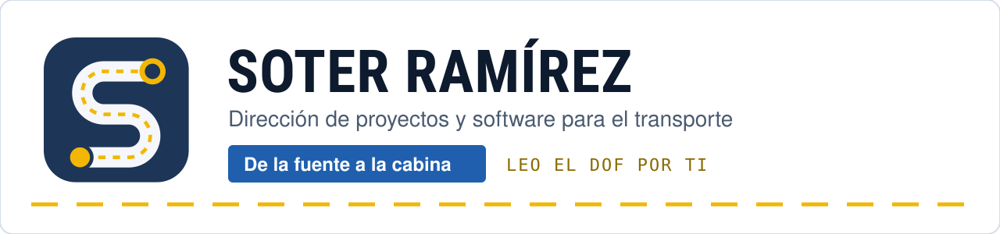
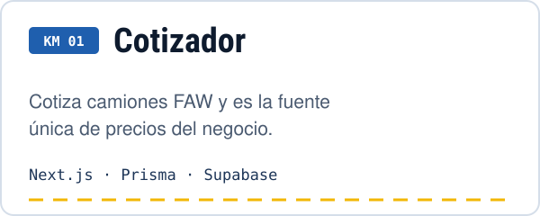
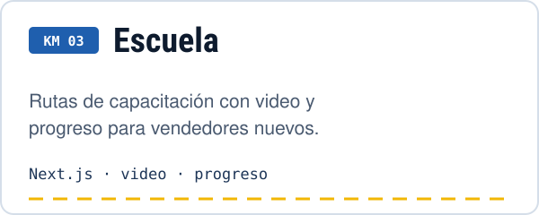
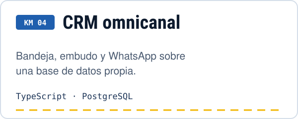
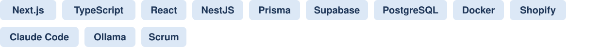

<picture>
  <source media="(prefers-color-scheme: dark)" srcset="assets/banner-dark.svg">
  
</picture>

Ingeniero en sistemas y maestro en Dirección de Proyectos. Construyo software para el autotransporte y traduzco lo que sale en el DOF a lenguaje de operador, siempre con la fuente oficial enlazada.

### Qué hago hoy

- 🚚 Trabajo en **Vendotractos** (distribuidor FAW, Texcoco): dirijo producto, sistemas y marca.
- 📄 Escribo en **[blog.soterramirez.dev](https://blog.soterramirez.dev)**: dirección de proyectos y carretera, leídos en la fuente.
- 🎬 Hago reels animados en código para operadores: *El Perico y Tuerca*.

### Lo que he construido

<picture>
  <source media="(prefers-color-scheme: dark)" srcset="assets/card-cotizador-dark.svg">
  
</picture>
<picture>
  <source media="(prefers-color-scheme: dark)" srcset="assets/card-odette-dark.svg">
  
</picture>

<picture>
  <source media="(prefers-color-scheme: dark)" srcset="assets/card-escuela-dark.svg">
  
</picture>
<picture>
  <source media="(prefers-color-scheme: dark)" srcset="assets/card-crm-dark.svg">
  
</picture>

Son sistemas internos en producción; por eso se describen aquí sin enlace al código.

### Para la comunidad

- 🧰 **[Cabina](https://github.com/SoterRamirez/cabina)**: la navaja suiza del operador de camiones. Horas de manejo con aviso de pausa, emergencias, doble cobro IAVE, físico-mecánica, humo, gastos del viaje y bitácora. Funciona sin señal y guarda todo en el celular. [Úsala aquí](https://soterramirez.dev/herramientas/). Código abierto, con fuentes del DOF.

### Lo último del blog

<!-- BLOG-POST-LIST:START -->
- [Las cuatro actividades de la gestión de configuración, en el día a día](http://blog.soterramirez.dev/2026/11/las-cuatro-actividades-de-la-gestion-de.html)
- [El Reglamento de Tránsito en carreteras federales cambió dos veces en 2026](http://blog.soterramirez.dev/2026/11/el-reglamento-de-transito-en-carreteras.html)
- [Configuración: qué está bajo control](http://blog.soterramirez.dev/2026/11/configuracion-que-esta-bajo-control.html)
- [Los cinco grados del fracaso, y por qué importa distinguirlos](http://blog.soterramirez.dev/2026/11/los-cinco-grados-del-fracaso-y-por-que.html)
- [Para carga: cero alcohol](http://blog.soterramirez.dev/2026/11/para-carga-cero-alcohol.html)
<!-- BLOG-POST-LIST:END -->

### Con qué trabajo

<picture>
  <source media="(prefers-color-scheme: dark)" srcset="assets/stack-dark.svg">
  
</picture>

### Formación

- Maestría en Dirección de Proyectos · UNITEC
- Ingeniería en Sistemas Computacionales · UNITEC

---

&nbsp;&nbsp;<b>@SoterRamirez</b>

