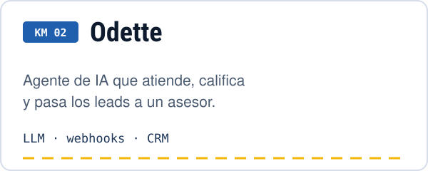

<picture>
  <source media="(prefers-color-scheme: dark)" srcset="assets/banner-dark.svg">
  
</picture>

Ingeniero en sistemas y maestro en Dirección de Proyectos. Construyo software para el autotransporte y traduzco lo que sale en el DOF a lenguaje de operador, siempre con la fuente oficial enlazada.

### Qué hago hoy

- 🚚 Trabajo en **Vendotractos** (distribuidor FAW, Texcoco): dirijo producto, sistemas y marca.
- 📄 Escribo en **[blog.soterramirez.dev](https://blog.soterramirez.dev)**: dirección de proyectos y carretera, leídos en la fuente.
- 🎬 Hago reels animados en código para operadores: *El Perico y Tuerca*.

### Lo que he construido

<picture>
  <source media="(prefers-color-scheme: dark)" srcset="assets/card-cotizador-dark.svg">
  
</picture>
<picture>
  <source media="(prefers-color-scheme: dark)" srcset="assets/card-odette-dark.svg">
  
</picture>

<picture>
  <source media="(prefers-color-scheme: dark)" srcset="assets/card-escuela-dark.svg">
  
</picture>
<picture>
  <source media="(prefers-color-scheme: dark)" srcset="assets/card-crm-dark.svg">
  
</picture>

Son sistemas internos en producción; por eso se describen aquí sin enlace al código.

### Para la comunidad

- 🧰 **[Cabina](https://github.com/SoterRamirez/cabina)**: la navaja suiza del operador de camiones. Horas de manejo con aviso de pausa, emergencias, doble cobro IAVE, físico-mecánica, humo, gastos del viaje y bitácora. Funciona sin señal y guarda todo en el celular. [Úsala aquí](https://soterramirez.dev/herramientas/). Código abierto, con fuentes del DOF.

### Lo último del blog

<!-- BLOG-POST-LIST:START -->
- [Estimar sin documentación es opinar con números](http://blog.soterramirez.dev/2026/11/estimar-sin-documentacion-es-opinar-con.html)
- [¿Te cobraron doble en la caseta? Así lo reclamas ante CAPUFE &lpar;IAVE&rpar;](http://blog.soterramirez.dev/2026/11/te-cobraron-doble-en-la-caseta-asi-lo.html)
- [Plan de calidad: prevenir o inspeccionar](http://blog.soterramirez.dev/2026/11/plan-de-calidad-prevenir-o-inspeccionar.html)
- [Técnicas de recolección: lo que la gente dice, lo que hace y lo que no sabe que quiere](http://blog.soterramirez.dev/2026/11/tecnicas-de-recoleccion-lo-que-la-gente.html)
- [¿Cuánto puede pesar tu tráiler y qué le pide la NOM-012 al full?](http://blog.soterramirez.dev/2026/11/cuanto-puede-pesar-tu-trailer-y-que-le.html)
<!-- BLOG-POST-LIST:END -->

### Con qué trabajo

<picture>
  <source media="(prefers-color-scheme: dark)" srcset="assets/stack-dark.svg">
  
</picture>

### Formación

- Maestría en Dirección de Proyectos · UNITEC
- Ingeniería en Sistemas Computacionales · UNITEC

---

&nbsp;&nbsp;<b>@SoterRamirez</b>

